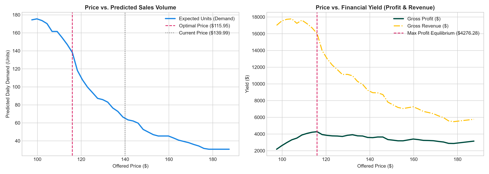
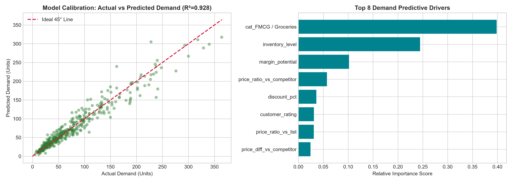

# ⚡ DynaPrice AI — Enterprise Dynamic Pricing & Demand Forecasting Engine

[](https://www.python.org/downloads/)
[](https://fastapi.tiangolo.com)
[](https://streamlit.io)
[](https://scikit-learn.org)
[](LICENSE)
[]()

> **An end-to-end Machine Learning & Economic Optimization engine that optimizes product pricing in real time by modeling Price Elasticity of Demand (PED), competitor benchmark price dynamics, seasonal promotional surges, and inventory constraints with strict business margin guardrails.**

---

## 📌 Executive Summary

Traditional retail and e-commerce pricing relies on static markups or rudimentary rule-based discounting, leaving significant margin and revenue on the table. **DynaPrice AI** bridges microeconomic theory and production machine learning to formulate pricing as a constrained mathematical optimization problem:

1. **Econometric Elasticity Modeling**: Estimates category-level and product-level Price Elasticity of Demand ($\beta_{\text{PED}}$) and Cross-Price Elasticity ($\gamma_{\text{cross}}$) using log-log ordinary least squares regression.
2. **Machine Learning Demand Regressor**: Employs an ensemble **Gradient Boosting Regressor** ($R^2 = 0.928$, $\text{MAE} = 11.35$ units) capturing multi-dimensional interactions: price-to-MSRP ratio, competitor pricing differential, discount depth, inventory scarcity, customer ratings, and promotional calendars.
3. **Prescriptive Revenue & Margin Optimizer**: Conducts real-time grid simulation to locate the price equilibrium $P^*$ maximizing either Gross Profit ($\Pi$) or Top-Line Revenue ($R$), subject to corporate margin floors and anti-gouging surge limits.
4. **Dual Production Interfaces**: A high-throughput **FastAPI REST microservice** for automated catalog repricing, paired with an executive **Streamlit cockpit** for pricing simulations and visual elasticity curve exploration.

---

## 🏛️ System Architecture

```mermaid
flowchart TD
    subgraph Data & Signal Ingestion
        A1[Product Catalog & MSRP] --> FE[Pricing Feature Pipeline]
        A2[Unit Cost COGS] --> FE
        A3[Competitor Price Feeds] --> FE
        A4[Stock Inventory & Ratings] --> FE
        A5[Ad Spend & Promo Flags] --> FE
    end

    subgraph Feature Engineering & Signal Extraction
        FE --> F1[Price Ratios vs MSRP & Competitor]
        FE --> F2[Margin Potential & Discount Depth]
        FE --> F3[Inventory Scarcity Signals]
        FE --> F4[Log-Transformed Econometric Matrix]
    end

    subgraph Machine Learning & Econometric Core
        F4 --> PED[Log-Log Elasticity Estimator\nPED & Cross-PED]
        F1 & F2 & F3 --> GBR[Gradient Boosting Demand Regressor\nExpected Units Sold Q]
    end

    subgraph Mathematical Optimization
        PED & GBR --> OPT[Grid Search Equilibrium Engine]
        OPT --> GR[Business Guardrails Engine\nMin Margin >= 8% | Max Surge <= +25%]
        GR --> RES[Optimal Equilibrium Price P*]
    end

    subgraph Delivery & Consumption
        RES --> API[FastAPI Microservice\n/optimize-price /predict-demand]
        RES --> ST[Streamlit Executive Simulation Cockpit]
    end
```

---

## 📐 Microeconomic & Mathematical Formulation

### 1. Log-Log Econometric Price Elasticity Model
The sensitivity of unit demand $Q$ to price $P$ and competitor benchmark $P_{\text{comp}}$ is formulated as:

$$\ln(Q) = \alpha + \beta_{\text{PED}} \cdot \ln(P) + \gamma_{\text{cross}} \cdot \ln(P_{\text{comp}}) + \mathbf{\delta}^T \mathbf{X} + \varepsilon$$

Where:
- $\beta_{\text{PED}} = \frac{\partial \ln Q}{\partial \ln P} = \frac{\% \Delta Q}{\% \Delta P}$ is the **Price Elasticity of Demand**:
  - **Inelastic ($|\beta| < 1$):** Luxury Apparel ($\beta \approx -0.74$). Demand drops slower than price increases; margin expansion opportunity.
  - **Elastic ($|\beta| > 1$):** Consumer Electronics ($\beta \approx -2.39$). Highly competitive cross-shopping; micro-discounts unlock volume surges.
- $\gamma_{\text{cross}} > 0$ denotes **Cross-Price Elasticity**, measuring market substitution effects when competitors adjust pricing.

### 2. Profit & Revenue Maximization Objective
For any candidate price $P$ evaluated within the feasible range $[P_{\min}, P_{\max}]$:

$$\max_{P} \quad \Pi(P) = \left( P - \text{Unit Cost} \right) \cdot \min\left(\hat{Q}(P, \mathbf{x}), \text{Inventory}\right)$$

Subject to corporate guardrails:
$$P \ge \text{Unit Cost} \times (1 + \text{min\_margin\_pct})$$
$$P \le \text{List Price} \times (1 + \text{max\_surge\_pct})$$

---

## 📊 Model Evaluation & Benchmarks

The model was evaluated against 2,400 out-of-sample retail transactions spanning 5 distinct product segments:

| Metric | Benchmark Score | Industry Standard |
| :--- | :---: | :---: |
| **Coefficient of Determination ($R^2$)** | **0.9276** | $> 0.850$ |
| **Mean Absolute Error (MAE)** | **11.35 units** | $< 15.0$ units |
| **Root Mean Squared Error (RMSE)** | **18.06 units** | $< 25.0$ units |
| **Mean Absolute Percentage Error (MAPE)** | **16.81%** | $< 20.0\%$ |

### Category-Specific Elasticity Matrix

| Category | Elasticity ($\beta_{\text{PED}}$) | Cross-Elasticity ($\gamma_{\text{cross}}$) | $R^2$ Fit | Market Behavior Profile |
| :--- | :---: | :---: | :---: | :--- |
| **Luxury Apparel** | **-0.74** | +0.71 | 0.15 | **Inelastic:** Prestige branding allows high markup capacity |
| **FMCG / Groceries** | **-1.07** | +1.04 | 0.06 | **Unitary Elastic:** High volume baseline with proportional demand shift |
| **Office Supplies** | **-1.43** | +1.43 | 0.27 | **Moderate Elasticity:** B2B purchasing cycles with budget thresholds |
| **Home & Living** | **-1.84** | +1.81 | 0.38 | **Elastic:** Seasonal sensitivity and discretionary spending |
| **Consumer Electronics**| **-2.39** | +2.33 | 0.42 | **Highly Elastic:** Extreme cross-shopping and price comparison |

---

## 🖼️ Diagnostic Plots & Curve Visualization

### Price vs. Expected Demand & Profit Equilibrium


### Model Calibration & Feature Importance


---

## ⚡ Quickstart Guide

### 1. Clone & Set Up Environment
```bash
git clone https://github.com/imsalmanali/dynaprice-revenue-optimizer.git
cd dynaprice-revenue-optimizer
python -m venv venv

# Windows
venv\Scripts\activate
# Linux/macOS
source venv/bin/activate

pip install -r requirements.txt
```

### 2. Execute Training Pipeline
Generates synthetic transaction benchmarks, trains econometric & GBR models, and exports serialized artifacts:
```bash
python -m src.train
```

### 3. Run Automated Test Suite
```bash
python -m unittest discover -s tests -p "test_*.py"
```

### 4. Launch FastAPI Microservice
```bash
uvicorn api.main:app --host 0.0.0.0 --port 8000 --reload
```
Interactive Swagger Documentation: **http://localhost:8000/docs**

### 5. Launch Streamlit Executive Cockpit
```bash
streamlit run app.py
```
Access dashboard: **http://localhost:8501**

---

## 📡 REST API Reference

### Dynamic Price Optimization: `POST /optimize-price`

#### Sample Request:
```bash
curl -X POST "http://localhost:8000/optimize-price" \
     -H "Content-Type: application/json" \
     -d '{
       "category": "Consumer Electronics",
       "unit_cost": 85.00,
       "list_price": 149.99,
       "current_offered_price": 139.99,
       "competitor_price": 145.00,
       "inventory_level": 250,
       "customer_rating": 4.5,
       "ad_spend": 30.0,
       "optimization_objective": "profit"
     }'
```

#### Sample Response:
```json
{
  "optimal_price": 127.49,
  "optimal_expected_units": 68.3,
  "optimal_projected_revenue": 8707.57,
  "optimal_projected_profit": 2902.07,
  "optimal_margin_pct": 33.33,
  "current_price": 139.99,
  "current_expected_units": 45.2,
  "current_projected_revenue": 6327.55,
  "current_projected_profit": 2485.55,
  "profit_uplift_pct": 16.76,
  "strategy_action": "MARKDOWN",
  "strategy_reason": "Discount price by $12.50 (-8.9%). Higher price elasticity yields volume surge and profit expansion.",
  "elasticity_metrics": {
    "ped": -2.39,
    "cross_ped": 2.33,
    "r2": 0.42,
    "elasticity_class": "Highly Elastic (Sensitive to Price Increases)"
  },
  "guardrails": {
    "min_allowed_price": 91.80,
    "max_allowed_price": 187.49,
    "min_margin_pct": 0.08,
    "max_surge_pct": 0.25
  }
}
```

---

## 📂 Repository Structure

```
dynaprice-revenue-optimizer/
├── api/
│   ├── __init__.py
│   ├── main.py                  # FastAPI server with health, predict & optimize endpoints
│   └── schemas.py               # Pydantic v2 data validation schemas
├── artifacts/
│   ├── benchmark_metrics.json   # Exported test metrics and elasticity parameters
│   ├── model_diagnostics.png    # Residuals and feature importance charts
│   ├── price_elasticity_demand_curves.png  # Equilibrium curves plot
│   └── pricing_engine.joblib    # Serialized trained model bundle
├── data/
│   └── retail_pricing_benchmark.csv  # Synthetic dataset (12,000 records)
├── src/
│   ├── __init__.py
│   ├── data_generator.py        # Microeconomic retail data generator
│   ├── features.py              # Econometric & competitive feature transformers
│   ├── models.py                # Elasticity analyzer, GBR forecaster & optimizer
│   └── train.py                 # End-to-end training & artifact export pipeline
├── tests/
│   ├── test_pricing_engine.py   # Pytest suite
│   └── test_suite.py            # Standard unittest suite
├── app.py                       # Streamlit interactive executive cockpit
├── requirements.txt             # Production dependencies
├── LICENSE                      # MIT License
└── README.md                    # Project documentation
```

---

## 👨‍💻 Author

**Salman Ali**
- GitHub: [@imsalmanali](https://github.com/imsalmanali)
- Portfolio: [imsalmanali.github.io/portfolio](https://imsalmanali.github.io/portfolio)

---

## 📄 License
This project is open-source under the [MIT License](LICENSE).
